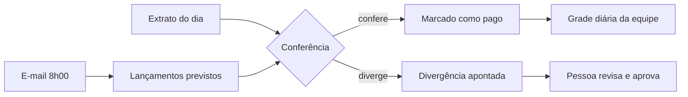

# Automação do fluxo financeiro

Automação da rotina financeira de um escritório de advocacia com duas unidades, usando tarefas agendadas no Claude Cowork.

**Status:** em implantação

> **Confidencialidade:** esta ferramenta foi construída para uso interno de um escritório de advocacia. O código e os dados não são públicos. Este repositório documenta o problema, a solução e os resultados, sem nomes de clientes, partes ou processos.

## Problema

Todo o financeiro era manual. Boletos, notas e avisos de crédito chegavam por e-mail e WhatsApp e eram digitados um a um numa planilha de fluxo de caixa diário. A conferência com o extrato bancário também era feita à mão.

## Como funciona

- Mapeamento da rotina completa: controle de saldo, pagamentos, emissão mensal de notas fiscais e boletos de honorários, compras e manutenção.
- Auditoria da planilha existente, que encontrou 4 falhas distorcendo os totais, como uma fórmula que ignorava o dia 31.
- Nova aba de lançamentos em lista, alimentada pelo Claude, que abastece a grade diária já usada pela equipe.
- Tarefas agendadas leem o e-mail às 8h00 e registram vencimentos como previstos. Após o extrato do dia, marcam como pagos e apontam divergências.
- Pagamentos continuam aprovados e executados por uma pessoa.

## Ferramentas

Claude Cowork (tarefas agendadas e conector Microsoft 365), Excel e extrato bancário em arquivo.

## Resultados

- Diagnóstico concluído, com 4 falhas de fórmula identificadas no fluxo de caixa.
- Projeto em implantação desde outubro de 2026.
